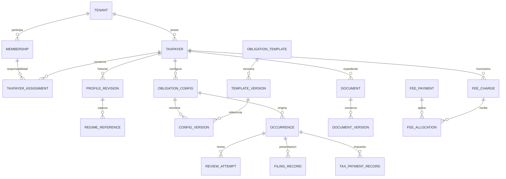

# Dominio fiscal v0.1.1 — propuesta revisada

**D74-01..05 aprobadas sólo para #34 por Dagt el 2026-11-12; sin implementación.** [Fuente/restricciones](../decisions/issue-74-owner-approval.md), [esquema](../data-model/schema-v0.1.1-proposed.md), [decisiones y OQ](../product/SPEC01-decisions-74.md). UUID/RFC/lifecycle, referencias manuales, bootstrap/matriz limitada, cuota y fronteras #34/#35/#36 están autorizados. Estados/reglas de módulos posteriores permanecen Proposed para revisión contable; no aprobación fiscal global.

## Límites y relaciones

Todas las relaciones del diagrama son tenant-safe; las FK triple del esquema impiden además mezclar contribuyentes dentro de un tenant. No hay expediente global compartido por RFC. identity conserva identidad, membresías/roles y mecanismo de autorización; taxpayers conserva perfil e historial/responsabilidades; obligations configuración/ocurrencias; workflow revisión; tasks trabajo administrativo; documents objetos privados/versiones; fees cuenta por cobrar; audit journal/outbox actuales. Puertos públicos Modulith, sin acceso a internals ni nuevos servicios/colas.

## Contribuyente y régimen

Taxpayer representa una relación de servicio del despacho con persona física/moral. UUID interno estable y RFC comercial normalizado; nombre legal y comercial no son credenciales. ACTIVE/ARCHIVED es ciclo administrativo, jamás situación ante SAT. Archivo conserva revisiones, grants e historia, impide nuevas operaciones ordinarias/generación futura; restauración requiere permiso explícito y cuota, conserva ID. Lectura del archivado sigue requiriendo grant. No delete físico.

D74-02 aprueba 0..10 referencias manuales con código de tres dígitos, fuente MANUAL, actor/instante, vigencia conocida/desconocida e historial PENDING_REVIEW, sin campo autoritativo único. Distintos regímenes pueden coexistir; ninguno determina obligaciones. El contador valida catálogo/códigos/vigencias fiscales y compatibilidades antes de usarlos como regla. No CSF parser, consulta SAT, homoclave calculada ni fecha de verificación inventada. Rechazo de RFC genéricos sólo por igualdad con valores documentados, corrección de RFC futura y excepciones pendientes según D74-01.

## Responsabilidad y acceso

Assignment describe PRIMARY, CONTRIBUTOR o REVIEWER con inicio/fin e historial. Un rol supervisor no es una asignación REVIEWER ni una aprobación fiscal. Máximo un PRIMARY vigente; colaboradores adicionales múltiples tras OQ-013. La cartera autorizada proviene de capacidad por rol **y** grant explícito por membresía/recurso/operación, no de la relación laboral o el responsable mostrado.

En #34 está aprobado sólo PRIMARY inicial del owner creador y cuatro grants exactos VIEW/EDIT/ARCHIVE/ASSIGN sobre el ID nuevo. VIEW/EDIT/ARCHIVE requieren habilitación inicial vinculada a versión/rol de membresía; ASSIGN queda reservado sin delegación operativa hasta #36. Ninguna nueva membresía/rol recibe cartera automáticamente. Cambiar responsable no altera permisos por inferencia; #36 diseñará comandos/revisión explícitos y acotados, con políticas concretas aún pendientes, sin listeners que concedan acceso.

**Regla aprobada obligatoria:** membresía ACTIVE, rol vigente, grant existente, habilitación efectiva y autorización final son conceptos diferentes. Grants/revisiones se conservan para trazabilidad, pero suspensión/reactivación o cambio de rol hace obsoleta la habilitación asociada a la versión anterior de membresía. Recuperar el rol anterior no recupera acceso. [Diseño versionado y locks](../security/FISCAL-PERMISSIONS-PROPOSAL-74.md) reutiliza los avances de versión de V11, sin cambiar su administración en #74. #34 valida esa revisión en autorizador/RLS y sólo crea habilitaciones de bootstrap; revisión de cartera anterior queda #36 y no es endpoint autorizado de #34. Sin revisión explícita, DENY.

## Obligación, período y configuración

Template es identidad estable del tipo de trabajo; TemplateVersion congela periodicidad y políticas de evidencia/revisión/vencimiento con su origen/aprobación. Config asocia un contribuyente con esa identidad de obligación y mantiene versiones de vigencia; los cambios requieren previsualización de impacto. Occurrence identifica config estable+período [inicio,fin), conserva versiones exactas y vencimiento/fuente originales. Cambiar versión no crea una segunda ocurrencia del mismo período ni reescribe la ya emitida.

Periodicidades iniciales y definición de períodos (mensual, anual u otras) quedan OQ-001; no seed de fechas legales. Fecha de vencimiento LocalDate con procedencia manual o regla revisada, jurisdicción y zona de cómputo; excepción/prórroga como evento autorizado con causa. Proyección “próxima/vencida” no cambia estado ni demuestra incumplimiento legal. No asumir día17 ni mover por fin de semana automáticamente. Un taxpayer ARCHIVED no genera nuevas ocurrencias; conservar las anteriores no significa cancelarlas.

Generación requiere comando idempotente aprobado y autoridad humana actual o autoridad de servicio específicamente diseñada. El outbox sólo transporta auditEventId: no es un calendario, scheduler ni principal fiscal. Configuración/plantilla y locks del período se revisan antes de #40. Las tareas recurrentes tienen serie propia, no se confunden con recurrencia fiscal.

## Estados y transiciones para validar

| Agregado/dimensión | Propuesta | Guardia / efecto / bloqueo |
|---|---|---|
| Taxpayer | ACTIVE→ARCHIVED; ARCHIVED→ACTIVE | Archive/Restore, expectedVersion, permiso por expediente, audit; restore comprueba cuota. D74-01/03/05 |
| Trabajo de obligación | PENDING→IN_PROGRESS→IN_REVIEW→APPROVED; rechazo a IN_PROGRESS; reapertura motivada | StartWork/SubmitReview/Approve/Reject/Reopen; revisión/evidencia y separación de funciones. OQ-002/005 |
| Aplicabilidad | APPLICABLE / NOT_APPLICABLE como decisión separada del avance | MarkNotApplicable con fundamento, no cancelar presentación/pago histórico. OQ-002; armonizar work_state.NOT_APPLICABLE de v0.1 después de decisión |
| Revisión por intento | DRAFT→SUBMITTED→APPROVED o REJECTED; nuevo intento; SUPERSEDED con causa | No borrar aprobación/rechazo previo; aprobación referencia evidencias concretas; autor distinto salvo excepción aprobada. OQ-005 |
| Presentación | NOT_FILED / REPORTED_WITHOUT_EVIDENCE / FILED_RECORDED | Provisional sólo si OQ-003 lo permite; RecordFiling exige fecha/actor/procedencia/evidencia o excepción autorizada. No SAT_VERIFIED disponible en MVP |
| Pago fiscal | UNDETERMINED / NOT_REQUIRED / PENDING / PARTIALLY_RECORDED / PAYMENT_RECORDED | Comandos explícitos con base/evidencia, motivo si no requerido, pagos append-only. UNDETERMINED evita inferir PENDING/NOT_REQUIRED sin decisión; OQ-002/004 |
| Tarea administrativa | OPEN→IN_PROGRESS→IN_REVIEW→DONE; rechazo/reapertura, CANCELLED motivado | Política de revisión propia; DONE no presenta declaración ni liquida impuesto |
| Documento versión | PENDING_UPLOAD→UPLOADED→VALIDATING→AVAILABLE o REJECTED/QUARANTINED | Hash/MIME/scan y permiso; ARCHIVED lógico no elimina evidencia referenciada. #46–48/OQ-008 |
| Honorario/cargo | DRAFT→ISSUED; PARTIALLY_PAID/PAID derivados de movimientos; VOIDED con reversión autorizada | Saldo/vencido derivados, no UPDATE status libre; OQ-011 |

La máquina histórica [obligation](../state-machines/obligation.md) usa NOT_APPLICABLE dentro del trabajo y no tiene UNDETERMINED de pago; [tax-payment](../state-machines/tax-payment.md) añade parcialidad. La propuesta separa aplicabilidad y explicita desconocimiento; **requiere decisión OQ-002**, no reemplaza silenciosamente esos documentos. Hasta validación no crear constraints fiscales definitivos. “Definitivo propuesto” significa que las relaciones están preparadas para revisión, no que los nombres de estado estén aceptados.

## Evidencia, documentos y hechos oficiales

Presentación, recepción oficial, pago fiscal, revisión humana y cierre administrativo son hechos distintos. Un usuario puede registrar FILED_RECORDED+PENDING mientras trabajo sigue IN_PROGRESS por pendientes internos; no deducir un estado del otro. Si el flujo exige aprobación antes de presentar, una excepción debe ser explícita y auditable. Documentar fecha del hecho y fecha de captura por separado.

FilingRecord y TaxPaymentRecord apuntan a versiones documentales concretas AVAILABLE y del mismo contribuyente/ocurrencia. Corrección/complementaria crea registro nuevo vinculado; importes tributarios sólo hechos capturados, sin motor de liquidación o compensación. Document logical metadata, versión y objeto físico tienen lifecycle separado; clasificación no es permiso. Comprobante manual y fuente externa llevan procedencia diferente, ninguna es SAT verificado sólo por ser PDF/XML. Una futura fuente oficial necesitaría contrato de verificación/frescura/alcance y aprobación; no campo editable satVerified.

Certificados sólo tipo/fecha/fuente/estado de revisión/historial de renovación, no claves, .cer, .key ni contraseñas. Archivo administrativo y acuse fiscal se clasifican y autorizan de forma distinta; el permiso de subir no concede descargar/compartir.

## Honorarios y dinero

FeeAgreement define servicio/cadencia/vigencia; FeeCharge crédito del despacho por servicio recurrente o extraordinario; FeePayment ingreso registrado de **ese contribuyente**; Allocation aplica parcialidad; Adjustment/reversal conserva historia. Adeudo/aging se deriva de cargos, ajustes y aplicaciones netas. Cancelar o corregir conserva movimientos originales y motivo; sobrepago y escala/redondeo requieren OQ-011.

TaxPaymentRecord es impuesto del contribuyente y no participa en esos saldos. No “Payment” genérico compartido. Reportes y UI usan títulos distintos: “Honorarios del despacho” y “Pago de impuestos registrado”; no total combinado. No cobros, emisión CFDI/PAC, bancos ni facturación en #74/#34.

## Auditoría y revisión final de dominio

Cada mutación confirmada incluye perfil/historia/evento/outbox/recibo atómicos. Journal tipado sin RFC/nombres/documentos/bodies; detalle histórico privado dentro de expediente con autorización. Correcciones, archivo, reasignación y reaperturas no destruyen atribución. Decisiones de denegación siguen política privada vigente; no prometer auditoría de cada lectura de PII sin diseño/retención aprobados.

Trazabilidad: FR-012..031/040..065, BR-010..064, NFR-001..009/020..026/030..036; ADR-003/005/007/008/010/014/015 conservan Proposed como documentos globales. D74-01..05 aprueban el corte #34 y el diferimiento explícito de OQ-001..006/013/015/023 fuera de su alcance parcial. #38–45/documentos/honorarios requieren contador y aprobación propia; no funciones fiscales productivas por el mero merge de esta especificación.
