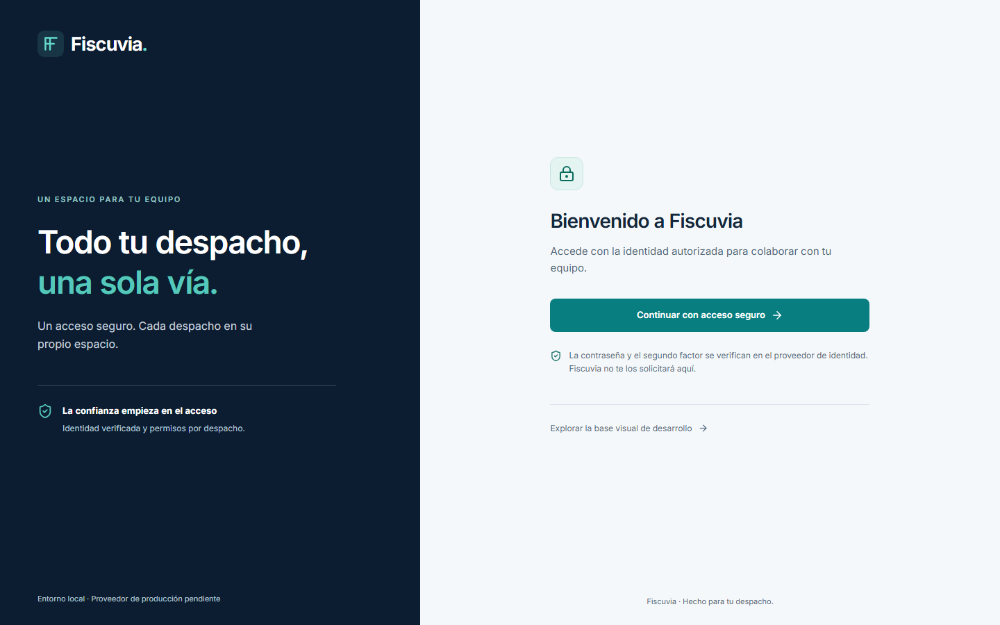
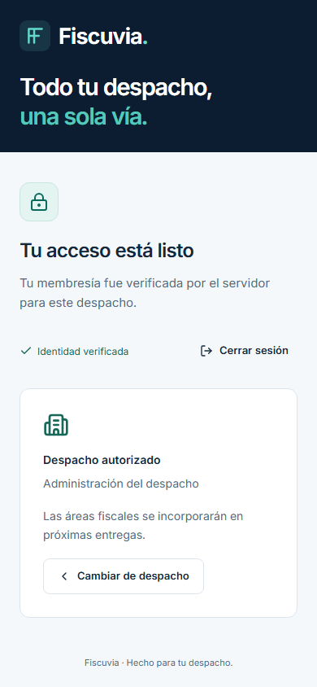

# Evidencia real de auditoría UX-00 — #19

Estas son capturas de **Fiscuvia ejecutándose en Chromium**, no mockups ni collage conceptual recuperado. La UI corresponde al main `3621a7d1e319f6ec8bbedad5db015d4a98a8591c`; el [manifest](capture-manifest.json) fija fecha UTC, commit de origen, árbol Git completo `web`, versión Chromium, hashes de herramientas/PNG, dimensiones y resultados observados. El PR registra su head final y los cinco jobs. Como #19 no cambia `web`, se comprueba que ese árbol sigue idéntico en el head final: no se afirma que el commit de origen contuviera esta biblioteca o herramientas nuevas.

## Galería

| Vista y procedencia | Escritorio1440×900 | Móvil390×844 |
|---|---|---|
| Login con OIDC local disponible | [Login](login-1440.png) | [Login](login-390.png) |
| Selección entre membresías verificadas | [Selección](seleccion-1440.png) | [Selección](seleccion-390.png) |
| Despacho autorizado por backend | [Autorizado](autorizado-1440.png) | [Autorizado](autorizado-390.png) |
| Identidad real sin membresías | [Sin membresías](sin-membresias-1440.png) | No capturada en esta auditoría; no se cuenta como evidencia nueva |
| Fallo OIDC real por state alterado | [Error](error-autenticacion-1440.png) | [Error](error-autenticacion-390.png) |
| Acceso a /app tras logout real invalidado | No capturada en esta auditoría | [Sesión expirada](sesion-expirada-390.png) |
| Shell público de desarrollo, rotulado demo | [Shell](shell-1440.png) | [Shell](shell-390.png) |
| Menú real con foco confinado | No aplica como drawer desktop | [Menú](menu-390.png) |
| Estado vacío **demostrativo** | [Vacío](demo-vacio-1440.png) | No capturada |
| Carga **demostrativa** | No capturada | [Loading](demo-carga-390.png) |
| Error recuperable **demostrativo** | [Error de interfaz](demo-error-1440.png) | No capturada |
| Sin permisos **demostrativo**, no denegación de expediente | No capturada | [Permisos](demo-permisos-390.png) |





## Reproducción y comprobación

Requiere Node24.13.1/npm11.8.0, JDK25 y Docker Linux/Ryuk. Usa el harness OIDC/Testcontainers ya existente, sólo perfiles sintéticos y HTTPS loopback. No requiere configuración productiva, cuenta externa ni secretos GitHub.

```sh
npm ci --prefix web
npm ci --prefix tools/ci --ignore-scripts
# Desde web: npx --no-install playwright install chromium
# En Ubuntu instalar además --with-deps chromium.
node tools/ci/auth-browser.mjs --reference-audit
node tools/ux/validate-reference.mjs
git diff --check
```

La opción de auditoría **no sustituye** las cinco pruebas OIDC normales ni las18 Playwright, ni instala un pipeline de visual-diff #56. Compila el harness en test-classpath, arranca Vite de desarrollo con BFF real y ejecuta `tools/ux/capture-reference.mjs`; después cierra Vite/JVM/PG/Keycloak y elimina el handoff privado. No usa respuestas mock ni modifica el DOM para simular módulos. No ejecutar `clean verify` simultáneo sobre el mismo target mientras compila el harness.

17 PNG de viewport (no full-page) a deviceScaleFactor1, fuentes listas, scroll al inicio y reduced-motion; el scroll vertical de contenido legítimo no es fallo. Se verifican dimensiones de bytes PNG, hashes y ausencia de overflow horizontal; axe A/AA aplicable en cada captura; foco de login y menú por teclado, confinamiento/Escape/retorno. Se revisan visualmente los PNG antes de publicar. No se capturan formularios del proveedor, cookies, tokens/CSRF, UUID visibles, secretos ni datos personales/fiscales reales. El handoff/logs/red privada nunca se versionan ni se suben como artifacts.

La selección usa perfiles separados de navegador; cerrar sesión se espera hasta `/login` y401 real antes de probar expiración, evitando carreras del capturador. La imagen de expiración demuestra navegación tras logout; la suite existente cubre expiración absoluta/inactividad. La de error corresponde a state realmente rechazado. La galería de `/desarrollo/estados` sigue siendo demo y se rotula como tal.

## Límites y revisión pendiente

[Comparativa escrita y hallazgos](../../reference-library/CURRENT-UI-AUDIT.md). No hay original para comparación pixel a pixel ni aprobación automática de estas imágenes; OQ-021 Open. Axe no cubre toda accesibilidad, contraste calculado no acredita todos los usos y no existe baseline de tolerancias pixel-diff. La revisión manual de dirección visual del propietario sigue pendiente. #52 implementará el kit tras decisión; #56 definirá regresión visual. Proveedor/MFA productivos, permisos OQ-015 y gate#74 intactos.
