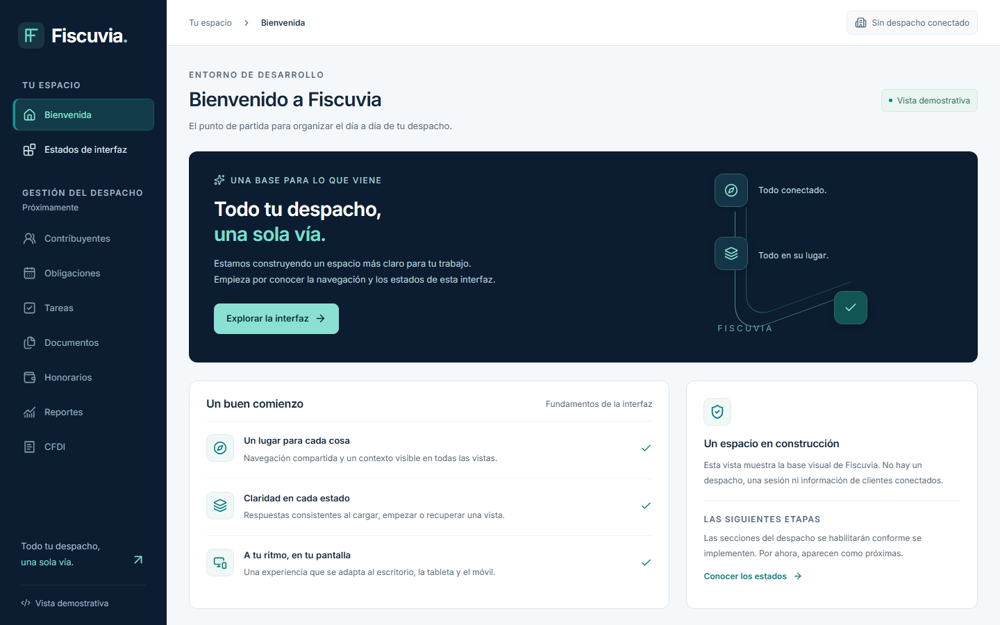
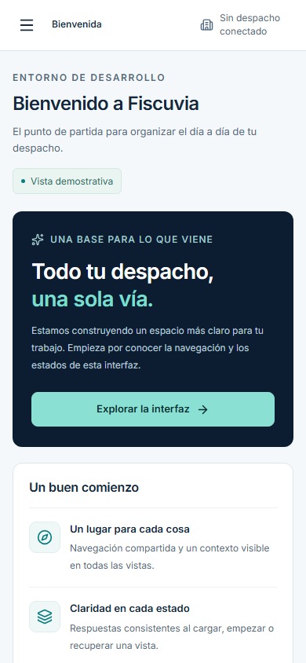
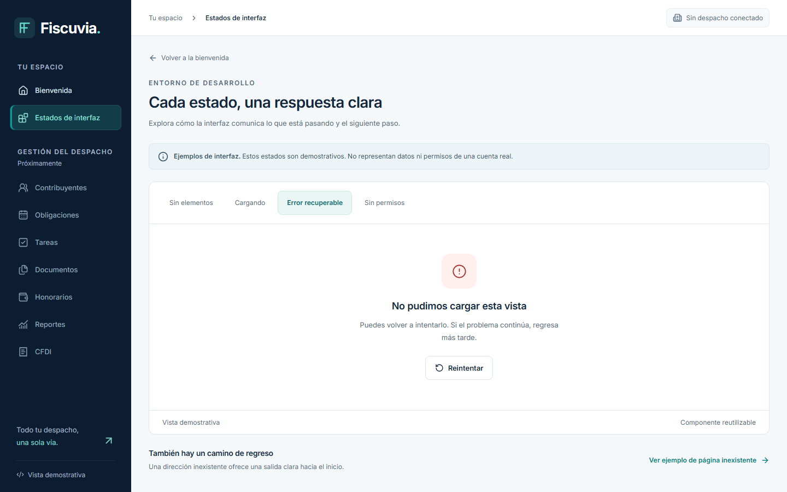

# Evidencia real de interfaz — issue #21

Fecha: 2026-10-29, America/Mexico_City. Base: `main` en `1d0590a834a7c776ad205de1974b4b8da12a9696`, PR #75 integrado por squash. El SHA final del código y de estas capturas se registra en el PR Draft de #21. No se modifica el backend.

Las imágenes se generaron con Playwright 1.64.1 y Chromium 156.0.8078.4 sobre **la aplicación ejecutándose**, compilada con Vite y servida en loopback mediante `vite preview`. No son imágenes de IA ni una reproducción del collage conceptual. Inter se espera con `document.fonts.ready`; las capturas no contienen clientes, métricas fiscales ni datos personales.

## Capturas

| Archivo | Tamaño | Contenido |
|---|---|---|
| [desktop-1440.png](desktop-1440.png) | 1440×900 | Bienvenida y navegación de escritorio |
| [compact-1280.png](compact-1280.png) | 1280×800 | Escritorio compacto |
| [tablet-768.png](tablet-768.png) | 768×1024 | Tableta, acceso al menú responsive |
| [mobile-390.png](mobile-390.png) | 390×844 | Primer viewport móvil |
| [mobile-390-full.png](mobile-390-full.png) | 390×1477 | Contenido móvil completo, scroll vertical normal |
| [mobile-menu-390.png](mobile-menu-390.png) | 390×844 | Menú móvil modal abierto |
| [state-vacio-1440.png](state-vacio-1440.png) | 1440×900 | Ejemplo explícito de estado vacío |
| [state-error-1440.png](state-error-1440.png) | 1440×900 | Error recuperable con acción de reintento |







## Validación ejecutada

Entorno local: Windows 11 amd64, Node 24.13.1, npm 11.8.0. Desde `web/`:

```powershell
npm ci
npm run typecheck
npm run lint
npm run format:check
npm test
npm run build
npx playwright install chromium
npm run test:e2e
npm ls --depth=0
```

- Instalación reproducible: 294 paquetes instalados; npm audit reportó **0 vulnerabilidades** en la resolución comprobada. Esto no sustituye una auditoría independiente.
- TypeScript: sin errores, modo estricto. ESLint: sin errores ni warnings. Prettier: formato consistente.
- Vitest + React Testing Library: **13 pruebas aprobadas**, sin omitidas. Incluyen entrada directa, redirección, navegación/selección/foco, inexistentes, áreas futuras deshabilitadas, estados y reintento/notificación local.
- Build de producción: exitoso. Playwright ejecuta ese mismo build, sin mocks de API ni servicios externos.
- Playwright: **13 pruebas aprobadas**, sin reintentos ni omitidas: 3 escenarios en cada uno de los 4 viewports más generación de evidencia.
- Los escenarios cubren recorrido/reload de rutas, ausencia de solicitudes API, errores JS, teclado, enlace de salto, menú con foco confinado, Escape, restitución de foco y traslado al contenido al navegar.
- axe: **0 violaciones detectadas** para reglas WCAG 2 A/AA, 2.1 AA y 2.2 AA en bienvenida, vacío, carga, error, permisos y 404, a los cuatro tamaños. También se revisa el diálogo móvil abierto. El análisis automático no equivale a certificación ni a pruebas completas con lectores de pantalla.
- Sin overflow horizontal en esos recorridos. Revisión adicional a 320 px y reflow mediante **CSS zoom 200%**; no se afirma equivalencia con todos los mecanismos de zoom de navegador/OS.
- Revisión visual directa de las ocho capturas: jerarquía, tipografía, distribución, bordes, foco, navegación, estados y adaptación móvil. Los controles principales tienen altura mínima de 44 px en CSS.
- Revisión de fuentes y búsqueda de patrones de credenciales: sin secretos/tokens de producción. No hay `.env`, almacenamiento local, cookies ni identidad ficticia. Sólo archivos de fuente, lockfile, licencias y evidencia sintética.

Desde la raíz:

```powershell
git diff --check
git diff --cached --check
git diff origin/main -- backend
git status --short
git rev-parse HEAD
```

La comparación de `backend/` es vacía. Los scripts/documentos y resultados se vinculan al SHA final en el PR. Los reportes/trazas detallados de ejecución permanecen locales, fuera de Git.

## Comparación contra la dirección documentada

| Especificación | Resultado y diferencia |
|---|---|
| Navy #0C1D31 / teal #087E80 | Sidebar y acciones usan esos tokens; selección con acento teal y texto/icono |
| Inter / Lucide | Fuente variable local e iconografía única; texto visible ES-MX |
| Shell 224–248 px / header 60–68 px | Sidebar de 240 px, barra de 66 px en escritorio; menú modal en móvil |
| Lienzo #F5F8FB, tarjetas blancas y bordes #DCE5ED | Aplicados, radios 8–12 y sombras contenidas |
| Jerarquía y tipografía | Títulos de 24–28 px; textos auxiliares de al menos 12 px; CTA principal visible |
| Contraste de texto secundario | Se oscurece el token propuesto #667A8F a #536B80, conforme al ajuste de contraste previsto por DESIGN-SYSTEM.md |
| Componentes y estados | Base mínima para bienvenida/estados; no se construyen tablas, filtros, formularios ni componentes de negocio de #52 |
| Contexto autorizado, búsqueda, alertas y usuario | Se muestra “Sin despacho conectado”; no se simulan capacidades aún inexistentes |
| Collage de seis pantallas | **No disponible.** El propietario autorizó usar las especificaciones en #21. No hubo comparación visual exacta ni aprobación de equivalencia |
| Marca gráfica | Monograma vectorial provisional para esta implementación; requiere revisión con la referencia original en #19/#52 |

Autoevaluación orientativa según VISUAL-ACCEPTANCE.md: marca 4/5, jerarquía 4/5, legibilidad 4/5, densidad apropiada al scaffold 4/5, responsive 4/5, accesibilidad 4/5, estados 4/5 y recorrido de tarea 4/5. Se sustenta en las capturas y pruebas anteriores; **no es aprobación visual del propietario**. La fidelidad exacta al concepto y la experiencia con datos operativos no pueden evaluarse en esta issue.

## Límites y revisión pendiente

**REMOTE CI NOT VERIFIED.** Esta entrega no crea workflows (#23). El estado remoto del SHA final se consulta y documenta en el PR; no se supone verde ni se atribuyen limitaciones a billing sin evidencia.

Sólo se ha probado Chromium en este entorno. Firefox/WebKit, lectores de pantalla y dispositivos físicos quedan para la ampliación de QA de #56. No hay baselines visuales aprobados, comparación automática contra snapshots ni kit completo de #52. Esas issues siguen independientes y abiertas.

Las páginas son demostraciones internas de presentación. Los módulos de negocio están deshabilitados; permisos, auditoría, aislamiento, OIDC y contratos API reales se incorporarán con sus issues. #21 no se usa para afirmar que esos comportamientos existen. PR Draft, sin merge, despliegue ni cierre manual.
