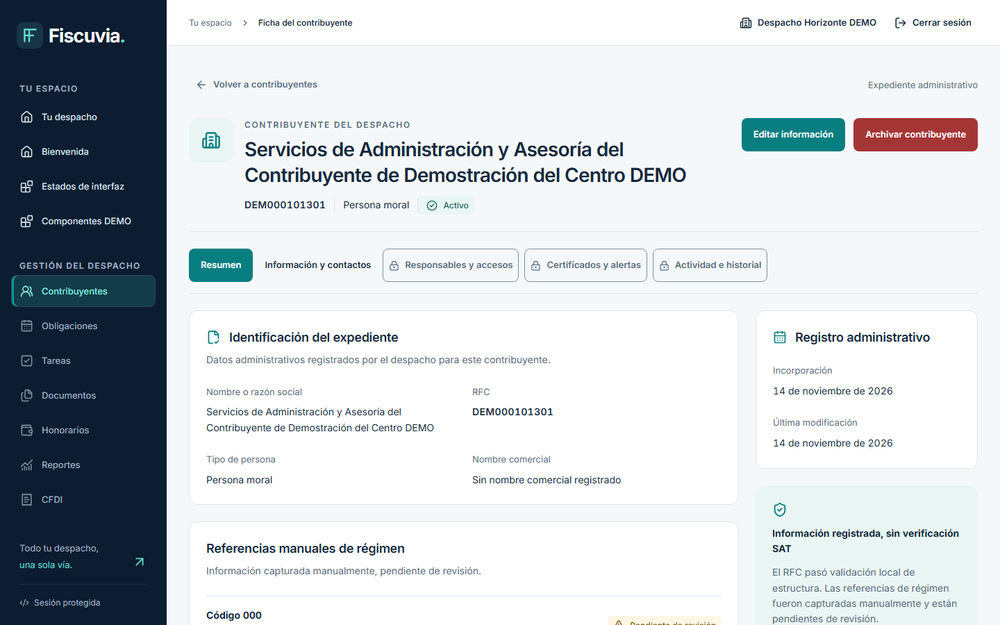
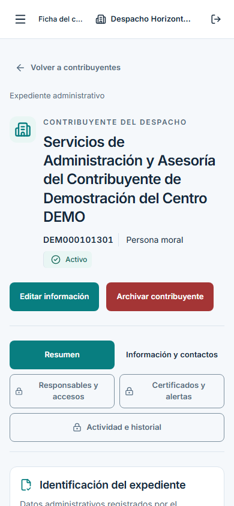

# C03 #36 — evidencia real de la ficha

Capturas de la aplicación React ejecutada en navegador, con backend Java, PostgreSQL 18 (Flyway V1–V13) y Keycloak/OTP reales. Datos e identidades exclusivamente sintéticos DEMO. Sin respuestas fiscales exitosas, permisos o datos fabricados en React. La interrupción de transporte del escenario08 aborta una solicitud real; el reintento vuelve al backend.

Fuente exacta, árboles de aplicación/backend/fixtures, Chromium, fecha UTC, resolución y SHA-256 de cada PNG: [capture-manifest.json](capture-manifest.json). El commit de documentación/evidencia puede ser posterior al commit fuente; `node tools/ux/validate-taxpayer-profile.mjs --current` exige árboles de aplicación coincidentes. No se publica el archivo privado de configuración OIDC ni sus secretos.

Fuente capturada: `e9b7d18cfa0863ab9bcfbec472529c78ff6e40c3`; Chromium156.0.8078.4, 2026-11-14T07:08:23.608Z. El validador comprobó22 PNG con sus dimensiones y SHA-256, y la coincidencia de árboles web/backend/fixtures.

## Escenarios y resultado esperado/observado

Cada escenario tiene captura de viewport1440×900 y390×844; se comprueba además reflow1280×800,768×1024 y320×844. El manifiesto debe contener22 imágenes. Los resultados siguientes sólo se consideran acreditados junto al manifiesto verificado y ejecución Playwright sin fallos.

| Archivo sin sufijo de resolución | Escenario / fuente | Resultado esperado y observado |
|---|---|---|
| 01-ficha-resumen | Alta real C01 y navegación desde directorio | Encabezado con nombre largo/RFC/persona/estado, perfil, referencias y fechas reales; acciones autorizadas |
| 02-informacion-alcance-pendiente | GET perfil; pestaña Información y contactos | Datos reales y aviso de contactos no habilitados; responsables/certificados/actividad deshabilitados, sin falsos vacíos |
| 03-formulario-administrativo | Formulario compartido de edición | Campos permitidos editables; RFC/persona inmutables; procedencia manual explícita |
| 04-conflicto-version | Segundo PATCH real durante edición | 409 conserva borrador, no confirma éxito y ofrece actualizar para revisar |
| 05-edicion-confirmada | PATCH y recibo reales | Perfil actualizado tras confirmación, sin optimismo local |
| 06-confirmacion-archivado | Comando C01 preparado | Diálogo de motivo y explicación de historial/RFC reservado |
| 07-ficha-archivada | POST archivals confirmado | Estado Archivado y restauración autorizada; historial conservado en backend |
| 08-error-recuperable | Transporte abortado, sin respuesta simulada | Error seguro y Reintentar, sin datos obsoletos visibles |
| 09-sin-permiso | Auxiliar real invitado/aceptado, GET denegado | Expediente no disponible, sin nombre/RFC/acciones fiscales |
| 10-contador-con-grant | Grant y revisión exactos sólo fixture privado | Perfil y edición disponibles; archivo ausente; asignación no deduce acceso |
| 11-referencias-vacias | Edición real con cero referencias | Mensaje de ausencia de referencias registradas; ninguna referencia SAT inferida |

## Revisión visual y accesibilidad

Referencia: S04 escrita aprobada por opciónB de OQ-021, [SCREENS-BASELINE](../../reference-library/SCREENS-BASELINE.md), [VISUAL-SPEC](../../reference-library/VISUAL-SPEC.md), [design system #52](../../DESIGN-SYSTEM-52.md) y directorio #35. El collage original continúa ausente; no se afirma pixel-diff con una imagen no disponible.

La ficha conserva sidebar navy, acciones teal, Inter, bordes/tokens/espaciado y componentes compartidos. Se diferencia del listado con encabezado de expediente, secciones y distribución principal/lateral de320px. En móvil apila datos, envuelve nombres y navegación interna, mantiene acciones táctiles y RFC legible. Los estados llevan texto además de color. El formulario, diálogo y conflicto conservan la composición compartida del directorio.

Axe se ejecuta en cada captura tras cargar fuentes y terminar transiciones finitas, sin exclusiones añadidas. Se comprueba ausencia de overflow horizontal en las cinco resoluciones. Vitest cubre foco/teclado de pestañas; los componentes compartidos conservan su cobertura de modales, zoom y reduced motion. Estas comprobaciones no constituyen certificación integral WCAG.

## Evidencia que permanece bloqueada

No existen capturas de contactos registrados, responsable principal nominal, certificados, próximos/vencidos o timeline porque sus contratos requieren D36-01/02. No se dibujan datos sintéticos en producción para aparentar su implementación. La navegación deshabilitada visible acredita el límite, no el cumplimiento de esas funciones. Los comandos de cartera/recuperación requieren además D36-03. [Matriz de aceptación](../../../delivery/VALIDATION-36.md).

Reproducir: commit del código, después `FISCUVIA_PROFILE_CAPTURE=1 node tools/ci/auth-browser.mjs` (PowerShell: asignar `$env:FISCUVIA_PROFILE_CAPTURE='1'`). El harness crea y elimina su entorno de pruebas; no instala fixtures ni grants en producción. El recorrido también comprueba restauración, supervisor, rol cambiado, suspensión/reactivación, mismo RFC en dos tenants, respuesta tardía y logout, aunque no todos generan otra captura.
