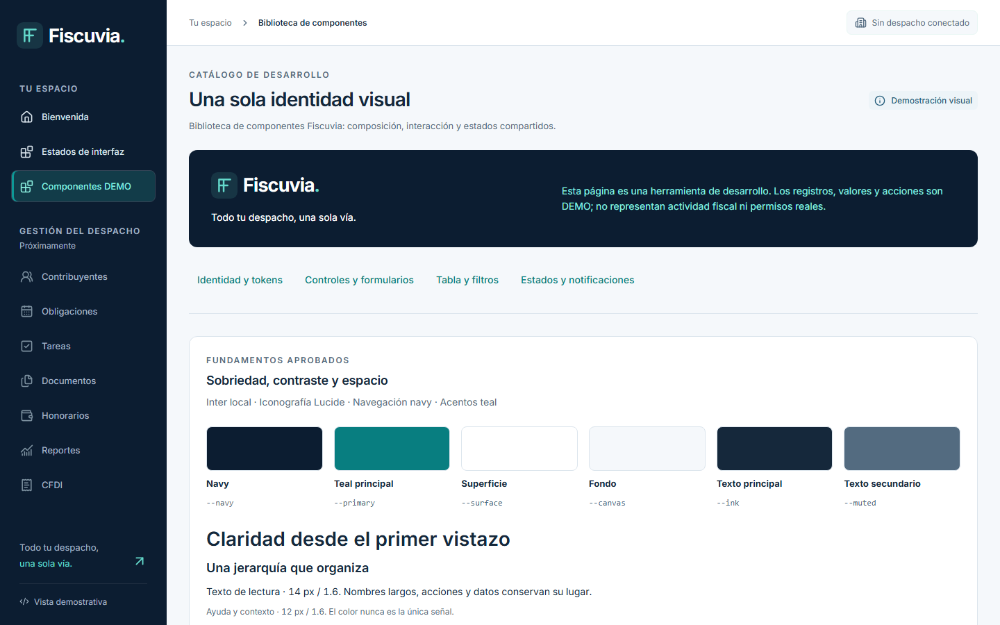
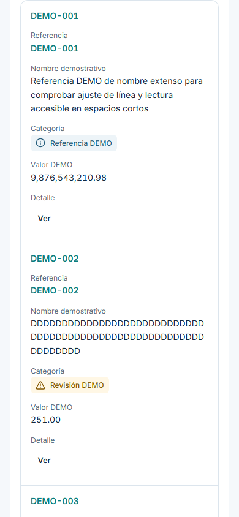

# Evidencia Chromium — #52

Base main `9007bca9388a2051da0acbd2e6836e524883fc48` (PR #87). Rama `issue-52-design-system-app-shell-components`. [Aprobación explícita Dagt, 2026-11-03, opción B OQ-021](https://github.com/Dagt/Fiscuvia/issues/52#issuecomment-6598264416). [Contratos implementados](../../DESIGN-SYSTEM-52.md). El collage original sigue ausente; se compara con la especificación escrita y las [capturas anteriores #19](../issue-19/README.md).

## Procedencia reproducible

`node tools/ci/auth-browser.mjs --design-system-audit` ejecuta el harness existente: PostgreSQL18.6, Keycloak local real, BFF y Vite HTTPS loopback. Chromium realiza Authorization Code/PKCE/MFA, selección y logout reales. No se capturan pantallas del proveedor, contraseñas, OTP, tokens, UUID internos ni datos personales/fiscales reales.

`capture-manifest.json` registra commit fuente, tree web, versiones/hashes del capturador/harness, timestamp, Chromium, dimensiones PNG, SHA256 y comprobaciones por imagen. Las imágenes se versionan después del commit fuente para evitar auto-referencia imposible del hash Git. `validate-design-system.mjs` comprueba igualdad del tree web con HEAD final. Resultados locales y cinco links CI del SHA final se publican en el PR; no se presenta el source SHA de imágenes como ejecución CI.

```text
node tools/ci/auth-browser.mjs --design-system-audit
node tools/ux/validate-reference.mjs
node tools/ux/validate-design-system.mjs
```

Handoff `.ci-work/27-browser.json`, claves, sesiones y logs privados no se versionan. Los screenshots de suites anteriores se escriben en `.ci-work` para preservar los snapshots históricos #21/#27. La allowlist de artifacts Actions permanece sin PNG ni reportes crudos.

## Comparación y aceptación

| Elemento / criterio | Referencia | Implementación / evidencia | Diferencia y motivo |
|---|---|---|---|
| Identidad UX52-01 | Navy/teal, Inter, Lucide, ES-MX | login, catálogo y shell; tokens únicos | Tonos decorativos heredados consolidados a roles semánticos; sin Fleet Simple |
| Desktop UX52-02 | Sidebar240/header≥66/padding32 | shell-autenticado1440, catálogo1440/1280; geometría manifest | Sin buscador, bell o perfil ficticios |
| Responsive UX52-03 | drawer<1024, padding24/16, header≥64 | catálogo768/390 y menú-autenticado390 | Header crece con texto ampliado; menú largo scrollea verticalmente |
| Sesión UX52-04 | despacho autorizado por backend | selección, shell-autenticado, sin-membresías, expirada/error | Ordinales hasta nombres/logos autorizados #31; IDs ocultos |
| Datos UX52-05 | >100 DEMO, nombre100/cadena64/números grandes | tabla-p1/lista móvil y detalle-inline | Página10 de125; filtro local exclusivamente DEMO público |
| Estados UX52-06 | loading/empty/error/denied/disabled/pending/focus | tabla-carga/vacío/error/sin-permisos, controles, pendiente, foco | Retira filas/conteos/valores no disponibles; sin KPIs fiscales |
| Teclado UX52-07 | labels/errores/targets44 y foco | formulario-inválido, confirmación, drawer, menú | Validación DEMO, no una mutación de negocio |
| Accesibilidad UX52-08 | contraste, reflow320,200%,reduced-motion | axe por imagen, cuatro viewports y tests teclado | No certificación WCAG completa ni lector de pantalla |
| Evidencia UX52-09 | Chromium y SHA/tree | manifest verificable, imágenes reales | Sin pixel-diff contra original ausente; #56 independiente |
| Regresión UX52-10 | suites completas y cinco jobs finalSHA | reportes/gates y links en PR | Pending/skipped no se cuentan como éxito |

## Revisión y resultados

### Regresión encontrada en Ubuntu y corrección

La [primera ejecución remota](https://github.com/Dagt/Fiscuvia/actions/runs/41686371743) del head `e40629569914cbde5a7acf33599982d8ceb99f65` aprobó backend/OpenAPI/seguridad, pero Web CI falló28/29 en la prueba previa de zoom200%. No fue billing. El wrapper de acciones nuevo de PageHeader podía encogerse mientras su badge legado conservaba el ancho: en Linux se midió borde derecho1440.890625, scrollWidth1441 para viewport1440. Windows no mostraba overflow global, pero el wrapper ya era menor que su contenido.

Se corrige permitiendo wrap en PageHeader y evitando el encogimiento del grupo de acciones, sin overflow:hidden global ni tolerancia añadida a la prueba. La reproducción Linux aislada con Playwright1.64.1/Chromium156.0.8078.80 midió después1440/1440 y wrapper135/135. La imagen oficial se usó sólo como diagnóstico local, sin red, sin escrituras al repositorio ni servicio externo: `mcr.microsoft.com/playwright:v1.64.1-noble@sha256:2f05f8a734509a7b3f26a912639488ee08f58a7b292d14d62271bcff9038768f`. Los cuatro casos nuevos de `reflow.spec.ts` verifican la frontera del wrapper en bienvenida y catálogo además del ancho global; la prueba original queda intacta. La ejecución final y su SHA se enlazan en el PR; la ejecución fallida se conserva como evidencia.

Galería: login [1440](login-1440.png)/[390](login-390.png), shell autenticado [1440](shell-autenticado-1440.png)/[390](shell-autenticado-390.png), [menú móvil](menu-autenticado-390.png), catálogo [1440](catalogo-1440.png)/[1280](catalogo-1280.png)/[768](catalogo-768.png)/[390](catalogo-390.png), controles [desktop](controles-p0-1440.png)/[móvil](controles-p0-390.png), tabla [desktop](tabla-p1-1440.png)/[lista móvil](tabla-p1-390.png), [formulario inválido](formulario-invalido-390.png), [confirmación](confirmacion-390.png), [panel lateral](drawer-390.png), [error del panel](drawer-error-390.png), [detalle inline](detalle-inline-390.png), [error de tabla](tabla-error-1440.png), [sin permisos](tabla-sin-permisos-390.png), [foco](foco-1440.png), [pendiente](pendiente-390.png) y [notificación](notificacion-390.png). Todas las variantes figuran en el manifest, sin reemplazar la evidencia anterior #19.





Revisar login1440/390, catálogo1440/390, tabla-p11440/390, controles-p01440/390, confirmación, drawer, shell-autenticado y menú390. Tabla móvil con etiquetas/nombres completos; panel inline se apila; avisos DEMO. Las capturas son evidencia de ejecución, no aprobación automática del resultado.

La base conserva Java295 (270 Surefire+25 Failsafe), tools/ci16 y todas las pruebas anteriores. Los mínimos web aumentan por las nuevas suites, incluido OIDC real. Contadores/duración/resultado final se publican en el PR tras ejecutar [CI local](../../../delivery/CI.md). No se deduce éxito de archivos presentes.

No se implementan #31/#32/#33/#56, tablas fiscales, capacidades nuevas ni servicios externos. OQ-014/OQ-015/#74 siguen pendientes. La revisión humana visual, accesibilidad manual completa y pixel-diff conservan sus gates; fixtures no equivalen a negocio implementado.
